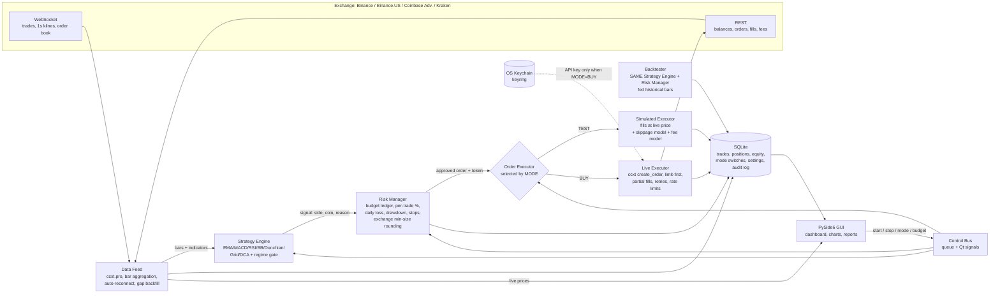

# Phase 0 Plan — Automated Crypto Trading App (TEST / BUY)

Status: **awaiting your approval. No code has been written.**

---

## Read this first: honest framing

1. **Most retail strategies do not beat buy-and-hold on BTC/ETH after fees.** Over any multi-year window that includes a bull run, a long-only timing strategy usually ends with less money than simply holding, because it is out of the market during part of the rise. What timing strategies *can* do is reduce drawdown (you lose less in crashes). That is a real benefit, but it is not "more profit".
2. **The app's genuine value is discipline and measurement**: hard budget caps, automatic stops, full logging, and an honest TEST-vs-BUY comparison. If after a few months TEST mode shows the strategy trailing buy-and-hold and DCA, the correct action is to not switch to BUY. The app will say that in plain English.
3. **Backtests lie in predictable ways**: survivorship (you pick coins that already went up), look-ahead, overfitting parameters, and ignoring fees/slippage/minimum order sizes. The backtester is designed to fight all four, and every result is shown against buy-and-hold and DCA.
4. **Fees decide everything at a $100 budget.** Trading on fast timeframes with retail fees is a guaranteed loss; see the fee table below.

Items marked ⚠️ are assumptions that could lose money.

---

## 1. Architecture



### Process model
- **GUI** runs in the main Qt thread.
- **Engine** (feed, strategy, risk, executor) runs in a **separate process** with its own asyncio loop (ccxt.pro is async). A crash or stall in the engine can never freeze the window, and the engine keeps trading while the window is minimised to the tray.
- Communication is two queues: engine → GUI (events: price, bar, signal, fill, alert, equity) and GUI → engine (commands: start, stop, set mode, set budget, emergency stop). A thin QThread drains the event queue into Qt signals.

### Three safety invariants (each has a dedicated test)
1. **Single choke point for money.** Every order object must carry an approval token issued by `RiskManager.approve()`. Both executors raise if the token is missing or stale. There is no other code path that creates an order.
2. **TEST mode cannot touch the exchange.** In TEST mode the engine is constructed with a `ReadOnlyExchange` wrapper whose `create_order`, `cancel_order`, and `withdraw` methods raise. The `LiveExecutor` class is not even instantiated. Switching to BUY rebuilds the engine with a real client; switching back destroys it.
3. **Budget is a hard ceiling.** The budget ledger (allocated / in use / available) is checked and *reserved* before any order, then settled on fill. Property-based tests (Hypothesis) generate thousands of random signal sequences and assert the ledger never goes negative and exposure never exceeds the cap.

### Stack decisions
| Concern | Choice | Why |
|---|---|---|
| Language | Python 3.12 | Stable, PyInstaller-friendly |
| Exchange | `ccxt` 4.x (ccxt.pro WebSockets are now bundled and free) | One API for all four exchanges |
| GUI | PySide6 6.7+ with **pyqtgraph** | Native Qt, fast candles, packages cleanly. `lightweight-charts` is JavaScript in a web view: heavier, slower to start, harder to package. |
| DB | SQLite in WAL mode via SQLAlchemy | Local, zero-admin |
| Secrets | `keyring` (macOS Keychain, Windows Credential Manager) | Never plain text |
| Settings | Pydantic models stored in SQLite | Validated, versioned |
| Tests | pytest + Hypothesis | Property tests for budget/mode invariants |
| Packaging | PyInstaller one-folder → `.dmg` / `.exe` installer | ⚠️ see Milestone 6 for signing caveats |

### Data notes
- Binance publishes native 1-second klines over WebSocket. Coinbase and Kraken do not, so the feed aggregates 1s bars from the trade stream on all exchanges (one code path, more robust).
- ⚠️ **1-second candles are for display only.** Signals are computed on the strategy's timeframe (default daily or 4h). Trading on 1s bars at retail fees loses money with near certainty.

---

## 2. Strategy comparison

### Fee reality (drives everything below)
| Exchange | Approx. taker fee per side (lowest tier) | Round trip |
|---|---|---|
| Binance.com | 0.10% (0.075% paying in BNB) | ~0.2% |
| Binance.US | varies by pair, some 0%, many higher | check in-app |
| Kraken Pro | ~0.25–0.40% | ~0.5–0.8% |
| Coinbase Advanced | ~0.4–1.2% | ~1–2% |

The app reads your actual fee tier live from the exchange rather than hard-coding these. ⚠️ **On Coinbase or Kraken at base tier, every strategy below except daily trend-following and DCA is likely unprofitable on a $100 budget.** Expect the backtester to tell you this.

⚠️ **Minimum order sizes.** $100 budget × 10% per trade = $10 orders. Binance's minimum is about $5 notional; Kraken's varies per pair and can exceed $10. The risk manager rounds to exchange lot/notional rules and *refuses* a trade that would fall below minimum rather than oversizing it. You may see "trade skipped: below exchange minimum" often at $100. A budget of $200–300 behaves much better.

### The strategies

| Strategy | How it works | Best conditions | Failure modes | Evidence for | Evidence against | Plan |
|---|---|---|---|---|---|---|
| **EMA crossover** (trend) | Fast EMA crosses above slow EMA → long; crosses below → flat. | Sustained trends (2020–21, 2023–24 style). | Whipsaws in ranges; typically 40–55% of trades lose; always late in and late out, giving back part of each move. | Time-series momentum is one of the best-documented return anomalies across assets (Moskowitz, Ooi & Pedersen 2012) and has been found in crypto (Liu, Tsyvinski & Wu 2022). | Published evidence is on daily/weekly bars. On hourly bars fees of 0.2%+ per round trip erase it. Lower drawdown, not higher return, is the realistic goal. | Include. Daily and 4h only. |
| **MACD** (trend) | Difference of two EMAs plus signal line; crossover or histogram sign flip. | Same as EMA. | More lag than EMA; 12/26/9 parameters are arbitrary and overfit easily. | Same momentum literature. | Almost no evidence it adds anything beyond EMA crossover. | Include as a variant, labelled as such. |
| **RSI mean reversion** | Buy when RSI < 30, sell when > 70 (or 2-period RSI extremes). | Choppy, range-bound markets. | **Catastrophic in trends**: keeps buying a falling market (May 2021, Nov 2022). Pay-off is many small wins and rare very large losses. | Short-horizon reversal exists in most markets, including crypto intraday. | Crypto crashes are fat-tailed; the losses in a crash can exceed a year of small wins. | Include **only** behind the regime gate (ranging regime) and with a hard stop. |
| **Bollinger Bands** (mean reversion) | Buy at lower band, exit at middle or upper band. | Same as RSI. | "Band walking" in trends: price rides the lower band down. | Same as RSI. | Same as RSI. | Include as mean-reversion variant, same gate and stop. |
| **Donchian breakout + volume** | Buy on N-day high with volume above average; exit on M-day low (the Turtle rule). | Start of big trends. | 60–70% of breakouts fail; crypto has frequent stop-hunts; stops are wide so positions are small. | Turtle track record; breakout systems in futures; crypto's large trends mean a few winners pay for many losers. | In a 6–12 month range it bleeds steadily. Depends on rare large trends arriving. | Include. The best fit of the trend family for crypto's fat right tail. |
| **Grid trading** | Ladder of buys below price and sells above at fixed spacing; profit from oscillation. | Sideways with high volatility and no drift. | Trending down → you accumulate inventory into a crash (unbounded loss without a floor). Trending up → you sell out early and watch. Small grids are eaten by fees. | Exchanges heavily promote it; it does earn steady small sums in ranges. | It is a **short-volatility bet**: small premiums collected, tail risk kept. Looks great until the one day it does not. | Include with mandatory floor stop and maximum inventory. Flagged in-app as highest tail risk. |
| **DCA baseline** | Buy a fixed amount at a fixed interval. | Any; it is not a timing strategy. | Full exposure to drawdowns; no exit. | Lump-sum beats DCA in expectation when drift is positive (Vanguard), but DCA has lower variance and regret. | Not a strategy, a benchmark. | Include as a selectable baseline **and** plotted on every backtest alongside buy-and-hold. |
| **Regime detection** | ADX (> 25 = trending), choppiness index, ATR percentile. Route to trend strategies when trending, mean reversion when ranging, cash otherwise. Also volatility targeting: smaller positions when volatility is high. | Reduces the worst failure of each family. | Regime indicators lag; regime *switches* are exactly where both families lose. Extra parameters → more overfitting. | Volatility clustering is real; volatility-managed positions improve risk-adjusted returns (Moreira & Muir 2017). | Predicting *direction* regime is far weaker than predicting *volatility* regime. | Implement as volatility targeting + ADX gate. Not sold as a predictor. |

### Why HFT, market-making, and arbitrage are not viable for a retail setup
- **High-frequency trading**: firms co-locate in the exchange's data centre at microsecond latency; a home connection is 20–200 ms. Exchange rate limits (Binance roughly 1,200 request-weight per minute) cap order rate. At retail fees you *are* the liquidity being picked off.
- **Market making**: you quote both sides and get hit by informed traders before you can update (adverse selection). Profitable only with maker rebates and VIP fee tiers that need millions in monthly volume, and you compete with Wintermute, Jump, GSR. Retail at 0.1% taker fees cannot quote tight enough to fill.
- **Cross-exchange arbitrage**: price gaps between major exchanges are usually smaller than fees plus withdrawal cost. Moving coins takes minutes (block confirmations) during which the gap closes. You must pre-fund both exchanges, halving capital efficiency. Triangular arbitrage inside one exchange lasts milliseconds and is nearly always negative after fees at retail tiers.

### Default strategy recommendation
EMA crossover on daily bars + volatility targeting + ADX gate, long-only, with ATR-based stop-loss and optional trailing stop. Rationale: the only family with strong external evidence, the lowest trade count (fewest fees), and it works at Binance fee levels on a $100 budget. ⚠️ It will likely *trail* buy-and-hold during a strong bull run; its payoff is smaller drawdowns.

---

## 3. Wireframes

**Global frame (every screen).** Left navigation rail; top bar with a mode badge that is always visible: `● STOPPED` grey, `● TEST` blue, `● BUY` red, plus connection status and exchange name. Minimising sends the app to the system tray; the tray icon shows the same colour.

### 3.1 First-run setup wizard (7 steps, progress dots at top)
```
┌─────────────────────────────────────────────────────────────┐
│  ● ● ○ ○ ○ ○ ○      Step 2 of 7 — Connect your exchange      │
│                                                              │
│  [ How to create a safe API key ]  (expandable panel)        │
│   • Enable: Read + Spot Trading                              │
│   • Disable: Withdrawals (we will refuse keys that allow it) │
│   • Restrict to your IP: your IP is 203.0.113.7  [copy]      │
│                                                              │
│  API key     [••••••••••••••••••••••••••••••]                │
│  API secret  [••••••••••••••••••••••••••••••]                │
│                                                              │
│  [ Test connection ]   ✔ Connected · Read ✔ · Trade ✔ ·      │
│                        Withdraw ✘ (good)                     │
│                                                              │
│  Keys are stored in your OS keychain and never shown again.  │
│  We never ask for a wallet private key or seed phrase.       │
│                                          [ Back ]  [ Next ]  │
└─────────────────────────────────────────────────────────────┘
```
Steps: 1 Exchange (Binance.com / Binance.US / Coinbase Advanced / Kraken, with a note on country availability) → 2 API key (above; **Test connection refuses to proceed if the key has withdrawal permission**) → 3 Budget (default $50, slider capped at $250) → 4 Coins (BTC and ETH pre-selected) → 5 Strategy (default above, one-paragraph plain-English description) → 6 Risk limits (defaults shown, editable) → 7 Review and `Start in TEST mode`.

### 3.2 Dashboard
```
┌──────┬──────────────────────────────────────────────────────────────┐
│ Dash │  ● TEST   Binance · connected · 14:02:11        [ TEST | BUY ]│
│ Mkt  ├──────────────────────────────────────────────────────────────┤
│ Coins│  [ ▶ START ]  [ ■ STOP ]                 [ ⚠ EMERGENCY STOP ]│
│ Strat├─────────────────────┬────────────────────────────────────────┤
│ Risk │ Budget              │ Equity curve (TEST, since start)       │
│ Hist │ Allocated  $100.00  │        ╱╲    ╱‾‾╲                       │
│ Setg │ In use      $31.20  │   ╱‾‾‾╯  ╲╱╯    ╲╱‾‾                    │
│ Help │ Available   $68.80  │ ──── buy-and-hold  ──── bot             │
│      │ Today P&L   -$0.42  │                                         │
│      ├─────────────────────┴────────────────────────────────────────┤
│      │ Open positions                                               │
│      │ Coin  Mode  Entry    Now      P&L     Stop     Take-profit   │
│      │ BTC   TEST  67,210   67,105   -0.16%  65,900   71,200        │
│      │ ETH   TEST   3,412    3,430   +0.53%   3,310    3,650        │
│      ├──────────────────────────────────────────────────────────────┤
│      │ Recent trades                                                │
│      │ 13:58 TEST BUY  ETH 0.0091 @ 3,412  EMA20>EMA50, ADX 31      │
│      │ 09:14 TEST SELL BTC 0.0002 @ 66,980 trailing stop hit        │
└──────┴──────────────────────────────────────────────────────────────┘
```
Emergency stop opens a confirmation listing every order to cancel and every position to sell, with the estimated proceeds, and requires clicking `Sell everything now`.

### 3.3 Live market
```
┌──────────────────────────────────────────────────────────────┐
│ ● TEST   Pair [BTC/USDT ▾]  Timeframe [1s|1m|5m|1h|4h|1d]     │
├───────────────────────────────────────────┬──────────────────┤
│ Candles + EMA20/EMA50 + Bollinger overlay │ Order book       │
│   ▲ TEST buy (hollow)  ▲ BUY buy (solid)  │ 67,112  0.84     │
│   ▼ TEST sell (hollow) ▼ BUY sell (solid) │ 67,110  1.20     │
│                                           │ ───── spread ─── │
│ RSI sub-pane  ──────30────────70──────    │ 67,108  0.55     │
│ Volume sub-pane ▂▃▅▂▁▃▇▂                  │ 67,105  2.01     │
│                                           ├──────────────────┤
│                                           │ Live trades      │
│                                           │ 14:02:11 B 0.01  │
└───────────────────────────────────────────┴──────────────────┘
```

### 3.4 Coin picker
Search box; table with checkbox, pair, price, 24h volume, 24h change, spread %, 30-day volatility; a `Suggested only` toggle that hides pairs under a liquidity threshold (default $50M 24h volume and spread under 0.05%). Selected coins appear as chips at the top.

### 3.5 Strategy
```
┌──────────────────────────────────────────────────────────────┐
│ Strategy [EMA trend + regime gate ▾]   [+ Add another]        │
│ Timeframe [1d ▾]  Fast EMA [20 ──●────] Slow EMA [50 ───●──]  │
│ ADX gate [25 ──●──]  ⓘ "Only trade when the market is trending│
│ Stop-loss 2.0×ATR  Trailing [on]  Take-profit [off]           │
│                                              [ Run Backtest ] │
├──────────────────────────────────────────────────────────────┤
│ Backtest: BTC/USDT 2022-01 → 2026-10, fees 0.1%, slip 0.05%   │
│  Equity: ── strategy  ── buy-and-hold  ── DCA                 │
│  Return +84%  vs B&H +141%  vs DCA +96%   Max DD -23% vs -61% │
│  Sharpe 1.1 · Win rate 44% · Profit factor 1.6 · 38 trades    │
│  Walk-forward: in-sample +9%/yr, out-of-sample +4%/yr          │
│  ⚠ This strategy made less than buy-and-hold but with far     │
│    smaller drawdowns. Out-of-sample return is less than half  │
│    of in-sample: mild overfitting likely.                      │
└──────────────────────────────────────────────────────────────┘
```
Every parameter has a plain-English tooltip. A "What is this strategy?" link opens the Help page for it.

### 3.6 Risk & Budget
Trading budget (big number, `Change…` button → performance stats + type the new amount twice; step capped at +50%; absolute cap $250 for the first 30 days of BUY). Per-trade max % (default 10). Daily loss limit (default 5%) with `Resume` button when tripped. Total drawdown limit (default 20%). Default stop-loss / trailing / take-profit rules. Slippage assumption for TEST mode. A read-only panel shows today's loss used and current drawdown from peak.

### 3.7 Trade history & reports
Filter chips `TEST` `BUY` `Both`; date range; table of every trade with reason, fees, slippage, P&L, exchange order ID (BUY only). Tabs: `Daily` `Weekly` `Monthly` summaries with bar charts; `TEST vs BUY` side-by-side over the same period (fill price difference, fee difference, P&L difference). `Export CSV` and `Export for taxes` (per-lot buys and sells with cost basis and proceeds).

### 3.8 Settings
Exchange connection (re-test, replace key; key never displayed). Notifications: desktop pop-ups on fill, stop, limit tripped; optional Telegram / Discord webhook. Start with computer. Theme. Log viewer with level filter and `Copy diagnostics`.

### 3.9 Mode switch dialogs
- **TEST → BUY**: shows TEST-mode stats (P&L, win rate, trade count, max drawdown, days in TEST) and buy-and-hold over the same period. Locked with a countdown until 14 days of TEST are complete. Requires typing `BUY`. ⚠️ 14 days is a minimum the brief asked for, not a statistically meaningful sample; the dialog says so and recommends 60–90 days.
- **BUY → TEST**: one click, then "Keep open real positions (they stay on the exchange, unmanaged) or close them now?"
- Every switch is logged with timestamp and the stats at that moment.

### 3.10 Help
Built-in guide: what each screen does, what each strategy does and when it fails, what the limits mean, how to read a backtest, how to create a safe API key, and a "what to do if…" troubleshooting page.

---

## 4. Milestone build plan

Each milestone ends with something you can run and see. Nothing in BUY mode until Milestone 5.

| # | Milestone | What you will see | Tests that must pass |
|---|---|---|---|
| 1 | **Shell + live data** | App opens in dark theme with navigation; live BTC/USDT 1s candles in the Market screen; auto-reconnect when Wi-Fi drops; SQLite created. | Bar aggregation from trades; gap backfill after reconnect. |
| 2 | **Strategy engine + backtester** | Strategy screen with all eight strategies, sliders, tooltips; `Run Backtest` downloads history and shows equity vs buy-and-hold vs DCA, walk-forward split, overfit warnings. | Indicator correctness against reference values; no look-ahead (unit test that shifts data and checks signals do not change); fee and slippage applied on every fill. |
| 3 | **Risk manager + TEST mode** | Dashboard live: START runs the bot in TEST mode on live prices; positions, stops, equity curve, trade feed, budget gauge all update. Daily loss and drawdown limits trip and show alerts. | Hypothesis property tests: budget never exceeded, exposure never exceeds cap, TEST mode engine has no path to `create_order`. Stop-loss always attached. |
| 4 | **Wizard, keychain, settings, tray** | First-run wizard end to end; keys in OS keychain; key-permission check refuses withdrawal-enabled keys; coin picker; notifications; tray icon; start-with-computer. | Keychain round-trip; permission check; settings validation. |
| 5 | **BUY mode** | Live executor with limit-first orders, partial fills, rejections, rate limits; restart reconciliation against exchange; TEST→BUY gate (14 days + type BUY); slippage per trade; TEST vs BUY comparison report; CSV and tax export. | Mode switch logging; gate cannot be bypassed; reconciliation with mocked exchange state; executor retries idempotent (no duplicate orders). |
| 6 | **Reports, Help, packaging** | Daily/weekly/monthly reports; built-in Help; `.dmg` and `.exe` installers. | Full suite green on Windows and macOS CI. |
| 7 | **Soak** | Runs in TEST mode for 14+ days on your machine; bugs fixed; then your call on BUY. | — |

⚠️ **Packaging caveat.** An unsigned macOS app triggers Gatekeeper ("cannot be opened because the developer cannot be verified"); you can right-click → Open once, or we notarise it with an Apple Developer account ($99/yr). Windows SmartScreen shows a warning for unsigned `.exe` files; a code-signing certificate avoids it. Neither affects function.

---

## 5. Decisions I need from you before Milestone 1

1. **Country and exchange.** Binance.com is not available to US residents; Binance.US has fewer pairs and different fees. Kraken and Coinbase Advanced are available in the US. Which exchange do you intend to use, and what country are you in? (Determines base currency too: USDT on Binance, USD/USDC on Coinbase and Kraken.)
2. **Default timeframe.** I recommend daily signals (4h as the fastest option). Agree?
3. **Default strategy.** EMA trend + volatility targeting + ADX gate, as above. Agree?
4. **14-day TEST gate.** Keep as specified, with the dialog recommending 60–90 days? Or raise the minimum?
5. **Code signing.** Do you have, or want to get, an Apple Developer account for notarisation? (Can be deferred to Milestone 6.)
6. **Telegram/Discord alerts.** Include in Milestone 4 or defer?

Reply with approval plus answers, or ask me to change anything in this plan.

---

## Decision log

- **2026-10-17** — User is in Maryland, US (Eastern Time). Binance.com is unavailable, including its public data feed. Default exchange set to **Kraken**; Coinbase Advanced and Binance.US offered; Binance.com listed as "not available in the US". Times are displayed in local time; the daily loss limit will reset on the Eastern calendar day.
- **2026-10-17** — Milestone 1 delivered: app shell, live 1s/1m/5m candles, reconnect with gap backfill, SQLite, 22 tests. Verified live against Kraken and Binance.US.
- **2026-10-17** — User approved daily timeframe and EMA trend as defaults. Milestone 2 delivered: 7 strategies + ADX gate + vol targeting on one shared signal path, backtester with hard budget cap, walk-forward validation, Strategy screen. Real 5-year BTC/USD daily result for the default config at 0.6% fees: +72% vs +64% buy-and-hold, drawdown 15% vs 69%, but weekly DCA +91%; 18 trades. Honest reading: lower-risk, not higher-return.
- **2026-10-17** — User has a Binance account; API key is NOT needed until Milestone 4/5 and must be entered only in the app's wizard, never in chat. Need to confirm it is Binance.US (Binance.com does not serve US residents).
- **2026-10-17** — User's account is Binance.US. Milestone 3 delivered: risk manager, simulated executor, TEST-mode trader, Dashboard, Risk & Budget screen; 83 tests incl. property tests that money at risk never exceeds the budget and that TEST mode has no path to a real order. Verified live: bot bought ~$24 of BTC/USDT (simulated) on Binance.US within seconds of START.
- **Deviation from the brief:** default per-position limit set to 25% instead of 10%. At a $100 budget a 10% position ($10) is at or below exchange minimum order sizes (Binance.US ~$10) and the bot would never trade. Changeable on the Risk screen.
- **2026-10-17** — User stated a goal of $100 → $2,500 (first in one month, then three months). Told plainly this is 25x and not achievable by this or any responsible system; the app is not tuned toward it. Building continues as specified.
- **2026-10-17** — User runs macOS and wants Windows too: both targeted in Milestone 6.
- **2026-10-17** — Milestone 4 delivered: wizard, keychain, connection/permission check, Coins screen, Settings, Discord/Telegram, tray, autostart; 90 tests. Finding: Binance.US has only ~3 pairs above $1M daily volume; Coinbase/Kraken are far more liquid.
- **2026-10-17** — Milestone 5 delivered: live executor (marketable limit, partial fills, idempotent retries), BUY-mode trader with reconciliation, TEST→BUY gate (14 days, key, $250 first-month cap, type BUY), BUY→TEST keep/close, History & Reports with comparison and CSV/tax export; 106 tests. User has a Binance.US key that can spot-trade but not withdraw; it is to be entered only in the app (wizard step 3 or Settings).
- **2026-10-17** — Milestone 6 delivered: built-in user guide + Help menu, P&L charts, PyInstaller spec, icons, macOS .app/.dmg build script (verified locally), Windows build script + Inno Setup installer + GitHub Actions workflow for both platforms (Windows build not run locally: no Windows machine here).
- **2026-10-17** — User asked for the "Crypto Pulse / Liquidity Pressure Divergence" strategy (a ChatGPT proposal). Implemented as a separate paper-only engine with a Pulse screen. Honest assessment given: at Binance.US costs (~0.1%/side + slippage) a 0.2% stop / 0.4% target needs ~75–83% win rate to break even; the EV gate enforces this; research mode paper-trades confirmed setups so the Market Memory fills with real after-cost outcomes. Short setups recorded, never traded (spot).
- Still open: Apple Developer ID / Windows code-signing certificate for warning-free installs. Milestone 7 (14+ day TEST soak) is running on the user's Mac.
